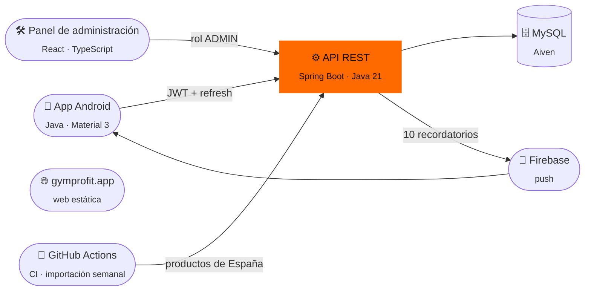

<div align="center">

<a href="https://gymprofit.app">
<picture>
  <source media="(prefers-color-scheme: dark)" srcset="documentacion/img/readme/portada-dark.svg">
  <source media="(prefers-color-scheme: light)" srcset="documentacion/img/readme/portada-light.svg">
  
</picture>
</a>

[](https://github.com/ruubeenn13/GymProFit/actions/workflows/ci.yml)
[](https://github.com/ruubeenn13/GymProFit/commits/main)
[](CHANGELOG.md)
[](https://api.gymprofit.app/api/actuator/health)

**[gymprofit.app](https://gymprofit.app)** &nbsp;·&nbsp; [Novedades](CHANGELOG.md) &nbsp;·&nbsp; [Decisiones de producto](documentacion/PRODUCT-DECISIONS.md) &nbsp;·&nbsp; [Despliegue](documentacion/DESPLIEGUE.md)

</div>

<br>

> [!NOTE]
> GymProFit nació como mi proyecto final de DAM y lo estoy convirtiendo en un producto de verdad, camino de Google Play. Todavía no está publicado: se reparte en APK a un grupo de prueba mientras se rehace la nutrición.

## Lo que hace

<picture>
  <source media="(prefers-color-scheme: dark)" srcset="documentacion/img/readme/modulos-dark.svg">
  <source media="(prefers-color-scheme: light)" srcset="documentacion/img/readme/modulos-light.svg">
  
</picture>

Empiezas respondiendo cinco preguntas (objetivo, nivel, tu cuerpo, dónde entrenas y cuántos días) y la app te da **tu plan**: un programa de entreno y tus calorías y macros del día. A partir de ahí, cada sesión, cada comida y cada medición alimentan lo demás.

## En cifras

<picture>
  <source media="(prefers-color-scheme: dark)" srcset="documentacion/img/readme/cifras-dark.svg">
  <source media="(prefers-color-scheme: light)" srcset="documentacion/img/readme/cifras-light.svg">
  
</picture>

## Cómo encaja todo



| Pieza | Dónde vive | Con qué |
|---|---|---|
| **App Android** | APK de prueba (Play, más adelante) | Java, vistas XML, Material 3, Retrofit, CameraX y ML Kit para el escáner |
| **API** | [Render](https://render.com), en `api.gymprofit.app` | Spring Boot 3.5, Spring Security, JPA + jOOQ, Flyway, MapStruct |
| **Base de datos** | Aiven for MySQL, con TLS verificado | 30 tablas, todo el esquema en migraciones |
| **Panel** | Cloudflare Workers, en `admin.gymprofit.app`, detrás de Cloudflare Access | React, Vite, TypeScript y Vitest, sin librerías de componentes |
| **Web** | Cloudflare Pages, en `gymprofit.app` | HTML y CSS: privacidad, términos y borrado de cuenta |

## Por dentro

<details>
<summary><b>📱 La app Android</b> — de la primera pantalla a la última serie</summary>

<br>

- **Navegación**: Inicio, Entrenar, Nutrición y Progreso sobre una barra flotante, y una pantalla propia para todo lo que se crea o se edita.
- **La sesión en vivo** vive en un repositorio que se escribe en disco a cada cambio: si Android mata la app a mitad del entreno, no se pierde ni una serie. El descanso suena con una alarma exacta aunque la pantalla esté apagada.
- **La nutrición** se está rehaciendo por lotes desde un lienzo de diseño aprobado: buscar «lo tuyo» primero, el «+» que añade sin preguntar, el escáner con su propia cámara, favoritos, copiar comidas, Mis platos, los platos propios que se apuntan de un toque, y «Lo que te encaja», lo tuyo que cabe en lo que te queda del día. Viene detrás el diario nuevo.
- **Todo en español e inglés, claro y oscuro**, accesible con TalkBack y con letra grande. Cada animación tiene su momento numerado y respeta «Quitar animaciones».
- **Sesión segura**: tokens cifrados en el dispositivo y renovación transparente cuando caducan.

Código en [`app/GymProFit`](app/GymProFit).

</details>

<details>
<summary><b>⚙️ La API</b> — Spring Boot, con la seguridad mirada con lupa</summary>

<br>

- **Autenticación con JWT de 30 minutos** y refresh token opaco, rotado en cada uso y revocable. Tres roles: invitado, usuario y administrador.
- **Nadie ve lo de otro**: el usuario sale siempre del token, y cada ruta con un id tiene su test de acceso ajeno contra un contexto de Spring de verdad, sin mocks.
- **Búsqueda de alimentos propia**: un índice en memoria sobre 198.000 productos de Open Food Facts y cientos de básicos de Ciqual y USDA, sin depender de ningún servicio externo mientras escribes.
- **Memoria con presupuesto**: cabe en los 512 MB del plan gratuito con cada parte de la JVM limitada y medida, y deja una línea en el log cada 10 minutos para vigilarlo.
- **Rate limiting por IP** en tres niveles y correo transaccional por HTTP.

Código en [`api/gymprofit-api`](api/gymprofit-api).

</details>

<details>
<summary><b>🛠️ El panel de administración</b> — catálogo y usuarios desde el navegador</summary>

<br>

Usuarios, ejercicios, alimentos y los avisos de datos que reportan los usuarios desde la app. Solo habla con la API con rol de administrador, guarda los tokens solo en memoria y no lleva ningún secreto: el repositorio es público. Se adapta del móvil al escritorio.

Código y detalles en [`admin`](admin).

</details>

<details>
<summary><b>✅ Calidad</b> — lo que tiene que pasar antes de llegar a producción</summary>

<br>

- **CI en GitHub Actions** para la API (contra una MariaDB que nace vacía), la app y el panel. La API solo se despliega si el CI está en verde.
- **Cada regla nueva se ve fallar** antes de darla por buena: se rompe a propósito el código y se comprueba que su test se pone en rojo.
- **Decisiones escritas**: cada decisión de producto o de arquitectura queda en [`PRODUCT-DECISIONS.md`](documentacion/PRODUCT-DECISIONS.md), con su contexto y lo que la haría cambiar.
- **Dependabot** propone las actualizaciones y solo se fusionan con el CI en verde.

</details>

## En marcha

- [x] El alta nueva: cinco preguntas y tu plan
- [x] La sesión en vivo, con descanso y récords
- [x] Buscar, escanear y añadir alimentos en un toque
- [x] Favoritos, comidas recientes y «¿Copiar la de ayer?»
- [x] Mis platos: tus recetas, por raciones o por peso
- [x] «Lo que te encaja»: sugerencias con lo que te queda del día
- [ ] El diario nuevo: agua, día completo y resumen semanal
- [ ] Publicación en Google Play

<details>
<summary><b>🚀 Arrancarlo en local</b></summary>

<br>

Necesitas **JDK 21**, **MariaDB** y **Android Studio**.

```bash
git clone https://github.com/ruubeenn13/GymProFit.git
cd GymProFit
```

**1. La base de datos.** Basta con crearla vacía: las migraciones montan el esquema al arrancar la API.

```sql
CREATE DATABASE gymprofit_db CHARACTER SET utf8mb4;
```

**2. La API.** Copia la plantilla de configuración, rellena la base de datos, la clave JWT y la contraseña del administrador, y arranca.

```bash
cd api/gymprofit-api
cp src/main/resources/application-example.properties src/main/resources/application-dev.properties
sh ./mvnw spring-boot:run
```

Queda en `http://localhost:8080/api`, con Swagger en `/api/swagger-ui.html`.

**3. La app.** En `app/GymProFit/local.properties`:

```properties
BASE_URL=http://10.0.2.2:8080/api/
```

Ábrela en Android Studio y ejecútala. `10.0.2.2` es tu ordenador visto desde el emulador.

**4. El panel**, si lo quieres:

```bash
cd admin && npm ci && npm run dev
```

La guía completa está en [`ENTORNO-DESARROLLO.md`](documentacion/ENTORNO-DESARROLLO.md), y cómo probar sin tocar producción, en [`ENTORNO-PRUEBAS.md`](documentacion/ENTORNO-PRUEBAS.md).

</details>

<details>
<summary><b>🗂️ Qué hay en cada carpeta</b></summary>

<br>

```
GymProFit/
├── app/            App Android
├── api/            API REST en Spring Boot
├── admin/          Panel de administración (React)
├── web/            gymprofit.app
├── db/             Esquema de referencia (el real, en las migraciones)
└── documentacion/  Decisiones, despliegue, entornos, diseño e informes de cada lote
```

</details>

## Créditos de los datos

Los alimentos básicos salen de **[Ciqual 2025](https://ciqual.anses.fr)** (ANSES, licencia abierta) y de **[USDA FoodData Central](https://fdc.nal.usda.gov)** (dominio público). Los productos envasados, de **[Open Food Facts](https://world.openfoodfacts.org)**, bajo licencia ODbL.

<br>

<div align="center">

Hecho por **[Rubén Juan Candela](https://github.com/ruubeenn13)** en Crevillente.<br>
<sub>¿Te interesa el proyecto? Escríbeme a <a href="mailto:rubenjuancandela06@gmail.com">rubenjuancandela06@gmail.com</a>.</sub>

</div>
