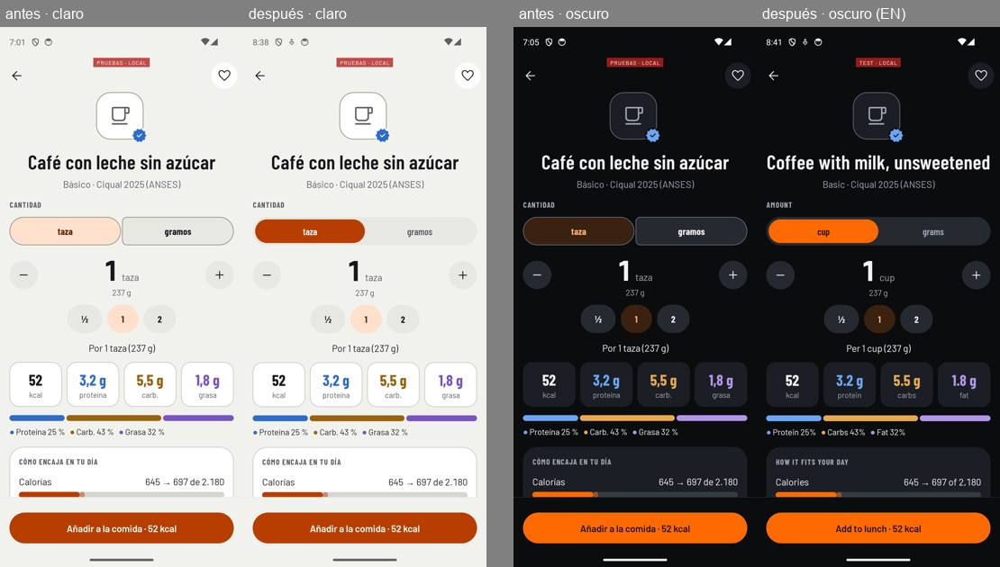
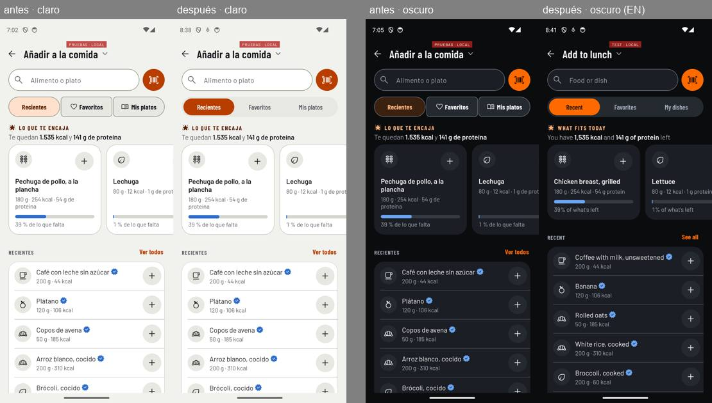
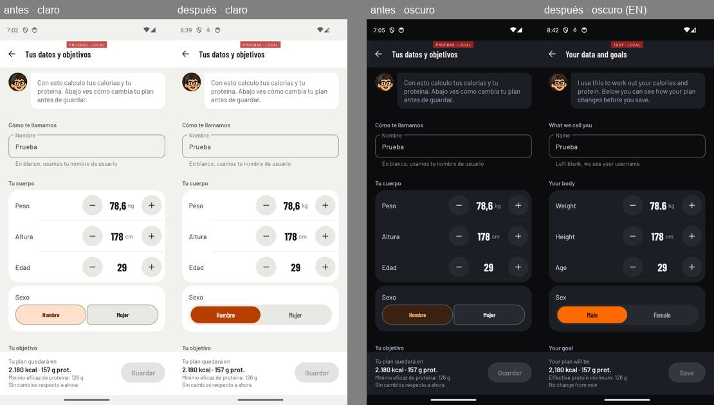
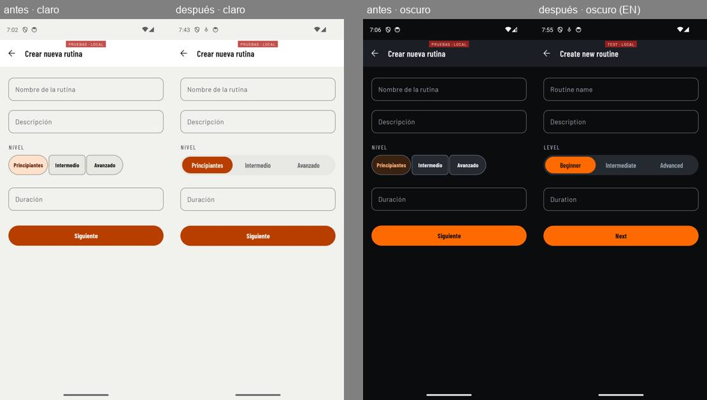
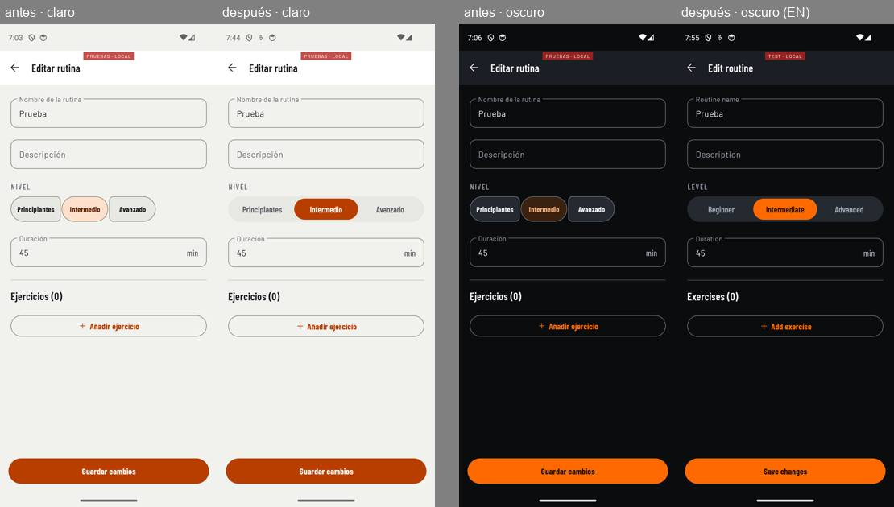
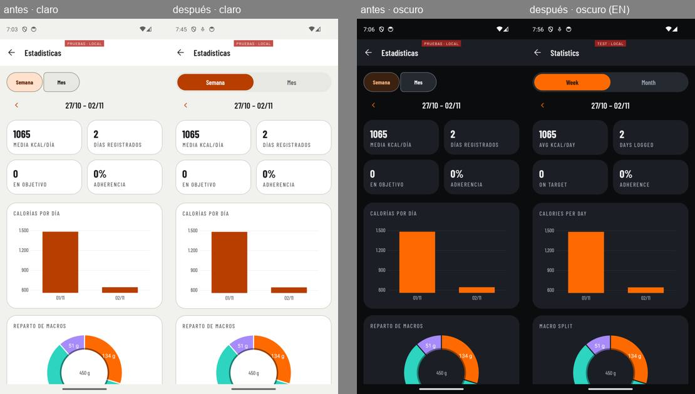
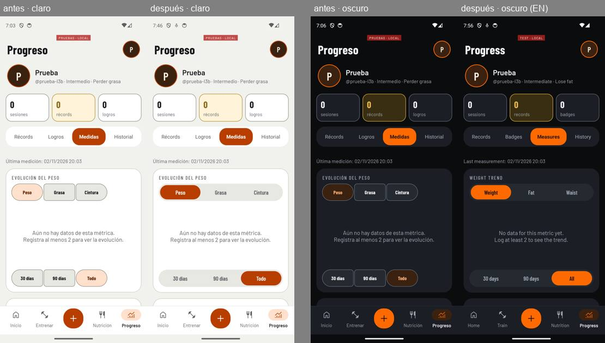
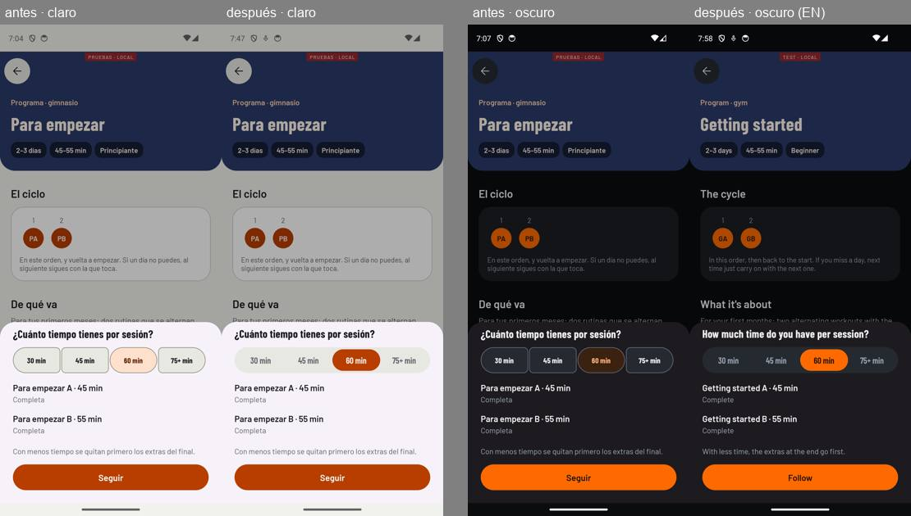
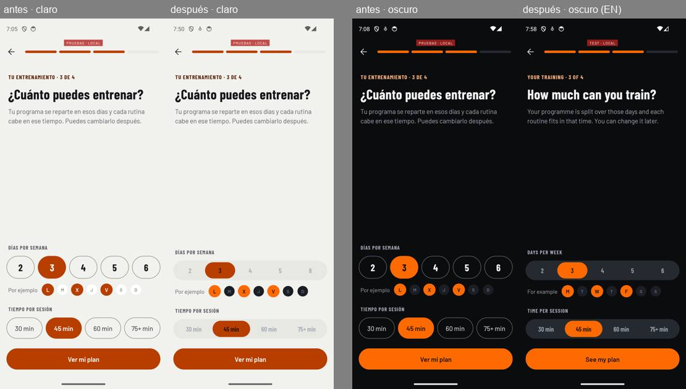

# GP-224: un solo selector de opciones en toda la app (2026-11-02)

El propietario aprobó el diseño el 02-11 en un lienzo que no está en el repositorio; la especificación del encargo es la referencia, y queda en `app/GymProFit/DESIGN.md` («Selector de opciones»). Solo app: la API no cambia. Sin versión ni etiqueta (DEC-056).

## Commits

| Hash | Qué |
|---|---|
| `bc2ca97` | feat(android): un solo selector de opciones en toda la app |
| `e757b85` | fix(android): 48 dp de toque, sílabas a letra grande, píldora de radio completo, «Guardar» de Tus datos |
| `756f929` | fix(android): los colores del selector no cambian de tema con la pantalla abierta |
| `1eecba8` | fix(android): la descripción de la actividad bajo su rótulo |
| `5daeb43` | fix(android): aviso de lint de la constante de corte |
| `c6b0206` | fix(android): la píldora mide lo que su opción al cambiar de opciones |

La fusión va por PR, sin coautor; su hash entra en el CHANGELOG con el siguiente lote.

## Qué entra

- **`SelectorPildora`** pasa de `ui/alta` a `ui/widget` y es la única pieza. Pista de 48 dp (`zona_tactil`), radio completo, 4 dp de relleno (`selector_relleno`), `gp_surface_2` y sin borde; píldora de 40 dp (`selector_opcion_alto`) en `gp_primary`; texto Barlow Condensed 600 a 16 sp. Sin opción elegida no hay píldora. Cada opción responde en los 48 dp; la píldora, la capa de pulsado (10 % de `gp_on_surface`) y el anillo de foco (2 dp) van 4 dp hacia dentro. Desactivada, al 38 % (`alfa_desactivado`).
- **Movimiento**: la píldora viaja con `PILDORA` y `REBOTE` (momento 6); el texto cambia de color con `TEXTO_OPCION` (200 ms, nueva, en la tabla de DEC-039); se hunde un 3 % (`animator/toque`). Con «Quitar animaciones», salta sin recorrido. Ningún número a mano (lo vigila `CimientosTest`).
- **Accesibilidad**: el grupo con nombre (`app:selectorNombreGrupo`), cada opción como botón de opción con estado y posición (`CollectionItemInfo`); en Añadir, `app:selectorPestanas`: «pestaña», seleccionada y su posición. A letra 1,3 parte en dos líneas, por sílabas con guion si una palabra no cabe.
- **El giro**: la vista guarda la elegida si tiene id. Tus datos guarda además su borrador, pero solo si el usuario ha cambiado algo (si no, una recreación antes de cargar el perfil encendía «Guardar»).
- **Las nueve pantallas**: ficha (unidad: con 2, selector; con 3 o más, el desplegable), Añadir (pestañas), Tus datos (sexo, actividad, experiencia), crear y editar rutina (nivel), estadísticas de nutrición (período), Medidas (métrica y rango), seguir un programa (minutos) y el alta (días y minutos, sin variante grande). Lo que guarda cada formulario no cambia.
- **Borrado**: `GrupoConectado`, `BotonConectado`, `view_boton_conectado`, `sel_unidad_fondo`, `sel_unidad_texto` y el `SelectorPildora` de `ui/alta`.
- **DESIGN.md**: componentes y roles («Selector de opciones»), Expressive (el selector ocupa el sitio de los botones conectados), la deuda de duraciones a mano de `SelectorPildora` cerrada y un hueco nuevo (15) con los selectores que quedan por pasar.

## Contrastes (medidos)

Calculados con la fórmula de WCAG y medidos por píxel en el emulador por el revisor:

| Pareja | Claro | Oscuro |
|---|---|---|
| Píldora contra pista | #B83E00 / #E8E8E3 · 4,58:1 | #FF6A00 / #252A31 · 5,03:1 |
| Texto elegido | #FFFFFF / #B83E00 · 5,63:1 | #1A0E00 / #FF6A00 · 6,61:1 |
| Texto sin elegir | #5A5C62 / #E8E8E3 · 5,44:1 | #A1A9B6 / #252A31 · 6,10:1 |

## Antes y después

Capturas reducidas en `documentacion/estado/2026-11-02-gp224/`: en cada imagen, antes y después en claro y antes y después en oscuro (la de oscuro de después, en inglés).

## Tests

- 878 unitarios en verde y `lintDebug` sin errores; 7 instrumentados de `SelectorPildoraTest` en verde (índice elegido, sin elección, grupo y opción para TalkBack, pestañas, giro, 48 dp, ancho de la píldora).
- Vistos en rojo antes del verde:
  - `SelectorPildoraTest.talkback_anuncia_el_grupo_y_cada_opcion…` (línea 93): el nodo de la opción no llevaba el nombre para TalkBack («Envase» llegaba como `null`; en el alta, «45 minutos» frente a lo que se ve, «45 min»). Arreglado en la pieza.
  - `SelectorPildoraTest.la_pildora_mide_lo_que_su_opcion_al_cambiar_de_opciones`: 326 px frente a 489 con el arreglo desactivado.
  - `CimientosTest.las_opciones_que_se_excluyen_van_en_el_selector_de_la_app` (línea 245), con un resto de `MaterialButtonToggleGroup` puesto a propósito.
  - `MovimientoTest.cadaDuracionDeLaTablaEsLaDelCodigo` (línea 55): `TEXTO_OPCION` no estaba en la tabla de DEC-039.

## Revisor de UI

Con las tres escalas de animación a 0 por adb, ES/EN × claro/oscuro × 1,0/1,3.

| Pasada | Pantallas | Resultado |
|---|---|---|
| Tanda 1 | Ficha, Añadir, Tus datos | 3 altos: «Guardar» encendido solo en claro, «Moderada» partida por letras a 1,3, toque de 40 dp; 2 bajos |
| Tanda 2 | Crear y editar rutina, estadísticas, Medidas, seguir programa, alta | sin altos; 2 medios y 3 bajos |
| Tanda 1, pasada 2 | Ficha, Añadir, Tus datos | los seis arreglos bien; 3 altos nuevos (ver abajo) |
| Tanda 1, pasada 3 | Ficha, Añadir, Tus datos | sin altos ni medios; 2 bajos |

Medios y altos y cómo se cerraron:

- **Colores del otro tema al encender un servicio de accesibilidad** (tanda 2, medio): el selector lee sus colores del tema una vez. Medido en Crear rutina, app en claro con el sistema en noche, tras encender y apagar el servicio: #5A5C62 sin elegir y #FFFFFF sobre #B83E00.
- **Altos 1 y 2 de la pasada 2** (el resto de la pantalla, no el selector, cambiaba a oscuro y al inglés): solo pasa con `MedidorAccesibilidad`, el servicio de depuración que corre dentro del proceso de la app. Con TalkBack de verdad (`com.google.android.marvin.talkback`), encendido 6 s y apagado con la Ficha y con Añadir abiertas, todo sigue en claro (medido por píxel por la pasada 3 y por mí). Es un efecto de la herramienta, no del producto.
- **Alto 3 de la pasada 2** (la descripción de la actividad aplastaba «Actividad física»): rótulo arriba y descripción debajo; la pasada 3 lo da por bueno en las cuatro combinaciones.
- **Otros selectores con su aspecto propio** (tanda 2, medio): las pestañas y el período de la ficha del ejercicio y las pestañas de Progreso no estaban entre las nueve pantallas del encargo. Quedan como hueco 15 de DESIGN.md, para decidir.
- **Carrusel de «Lo que te encaja»** (pendiente del lote 3): con las animaciones a 0 sale directamente en su estado final, en las cuatro combinaciones y en horizontal.

Bajos que quedan: con letra 1,3 elegir «Mucha» baja el selector de experiencia 24 dp (su descripción ocupa dos líneas); el corazón de la ficha a 10 dp del borde; los 4 dp laterales de la pista no responden; «Principiantes» en las rutinas frente a «Principiante» en el resto; «programme» y «program» en inglés; el fondo de la hoja de seguir programa es el lila de Material; el nombre accesible de las cifras de la ficha no dice «gramos».

## Producción

Release firmado contra `api.gymprofit.app`, cuenta nueva `prueba-224-f3738d` creada por el alta (objetivo, experiencia, datos, gimnasio, 3 días de 45 minutos con el selector nuevo, «Guarda tu plan»). La clave, solo en un fichero del scratchpad.

- Ficha y Añadir: pestañas Recientes, Favoritos y Mis platos; «Arroz blanco, cocido» de taza a gramos, 150 g, añadido y guardado (sigue tras cerrar la app).
- Tus datos: actividad Mucha y experiencia Avanzado, «Guardar»; el plan pasó de 2.507 a 2.790 kcal y se quedó al volver a entrar.
- Crear rutina «Prueba 224» (Intermedio, un ejercicio) y editarla a Avanzado: guardadas.
- Estadísticas: Semana → Mes recarga. Medidas: métrica y rango cambian la gráfica (vacía, sin datos).
- Seguir programa: «Para empezar» a 45 min, confirmado; Inicio dice «Hoy toca Para empezar A».
- **Fallo hallado y arreglado**: en una ficha nueva la píldora medía 434 px para una opción de 487. Tras `c6b0206`, en producción, 487 de 487.
- Borrada desde la app (contraseña y casilla). Después, su token da **401** en `/favoritos` (antes, 200) y el login, **401**. El fichero de la clave y el del token se borraron.

## Entorno y memoria

Un solo emulador; compilar con él apagado y `gradlew --stop` tras cada compilación. La API local se paró antes del release; el servicio MariaDB no se puede parar sin ser administrador. No faltó memoria. Dos trampas: los tests instrumentados desinstalan la app (y la sesión con ella), y el emulador, sin guardar instantánea, arranca desde la del 20-10 (con la 1.6.8 instalada): tras cada reinicio hay que reinstalar y entrar.

## Dudas

- ¿Se pasan al selector las pestañas y el período de la ficha del ejercicio y las pestañas de Progreso (hueco 15)?
- Los bajos, para un lote de pulido.
