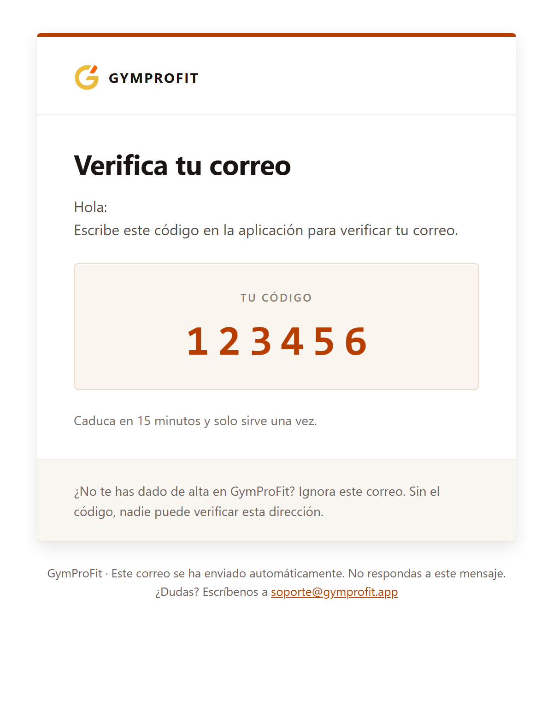
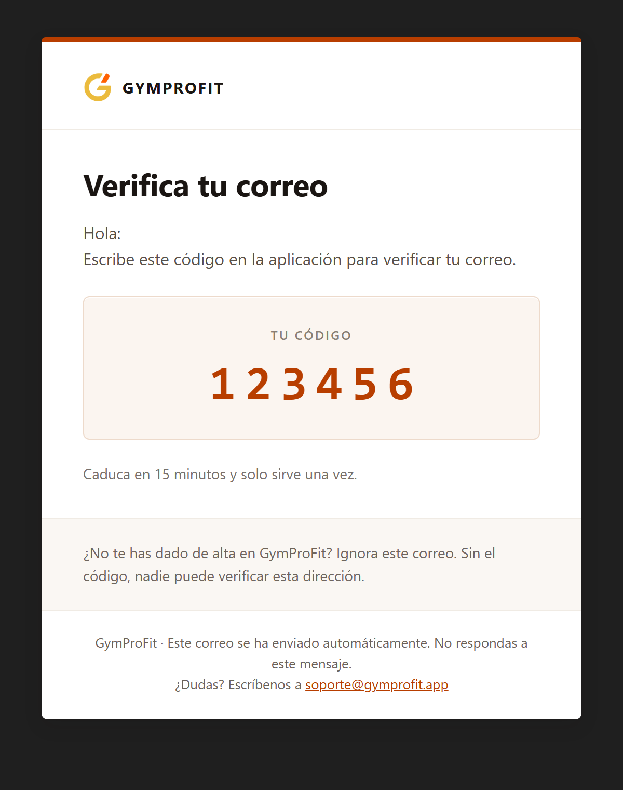
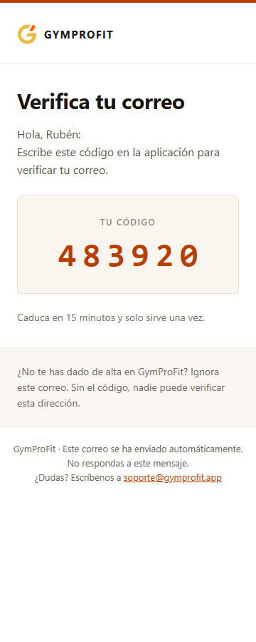
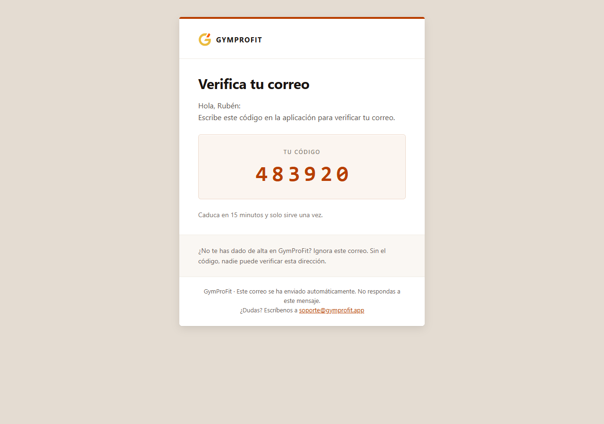

# Lote 25 · GP-266 el logo y el pie de los correos, GP-267 «Mira tu correo» desde Perfil

Tres ramas desde `main` en `30361286`: `lote-25-regla-hashes` (PR #124, fusión `3a5cfae0`),
`lote-25-gp267-verificar-desde-perfil` (PR #126, fusión `c833a9f0`) y
`lote-25-gp266-logo-correo` (PR #125, fusión `58a6f242`). Una cuarta, desde `58a6f242`:
`lote-25-gp266-correo-movil` (PR #127, fusión `63e3f837`). La web se subió a Cloudflare Pages
antes de fusionar la #125, para que el correo no saliera nunca sin logo.

## Commits

| Hash | Qué |
|---|---|
| `21516ec1` | docs(reglas): los hashes se copian de git, nunca de memoria |
| `8fca4ea7` | fix(api,web): el logo del correo, la G sola y sin fondo |
| `f5eb062a` | fix(android): desde Perfil, «Mira tu correo» pide un código nuevo y no abre en error |
| `088fa56d` | fix(api): el pie del correo, dentro de la tarjeta blanca |
| `3d5a71e6` | test(android): el logo de los correos es el único fichero de marca de más en web/img |
| `120d7693` | fix(api): en el móvil, el correo ocupa todo el ancho y sin marco beis |

Hashes copiados de `git log --format='%h %s' --abbrev=8 30361286..HEAD`.

## 1. GP-266, el logo de los correos

El apple-touch-icon que usaba la cabecera es opaco, con la baldosa oscura de la marca, y en
Gmail claro salía como un cuadrado negro. `web/img/logo-correo.png` es la G de los mismos
trazados del icono, sobre transparente, a 84 px (3x de los 28 que se pintan); lo genera
`scripts/trazar-g-arranque.py correo`.

**Comprobado en producción antes de fusionar.** `https://gymprofit.app/img/logo-correo.png`
da 200 `image/png`, 1878 bytes, el mismo SHA-256 que el fichero del repositorio. Con Pillow:
modo RGBA, 84 × 84, alfa 0 en las cuatro esquinas.

`LogoUnicoWebTest` (GP-231) fija los ficheros de marca de `web/img` y el PNG nuevo lo rompió en
el CI de la PR (`enImgNoQuedaOtroLogo`, en rojo). Se admite `logo-correo.png` como única
excepción; ninguna página puede usarlo, porque `todaImagenDeMarcaEsElLogoUnico` sigue exigiendo
`logo.svg` en cada ``.

## 2. GP-266, el pie dentro de la tarjeta

El pie iba en gris fuera de la tarjeta blanca, sobre el fondo exterior. Gmail en modo oscuro
cambia ese fondo por #1F1F1F y la tarjeta la deja blanca, así que el pie se quedaba en 2,76:1
(gris #6B6259) y el enlace de soporte en 2,93:1 (#B83E00). Ahora es la última fila de la
tarjeta, tras una línea de 1 px (#F0EBE4), y lleva las esquinas inferiores que antes tenía la
franja de cierre. Sobre blanco: gris 5,97:1 y enlace 5,63:1, AA a 13 px los dos. El fondo
exterior (#E4DCD2) no cambia.

**Test.** `PlantillaCorreoTest.elPie_vaDentroDeLaTarjetaConContrasteAA`: el pie está dentro de
la tercera tabla anidada (sin contar las ghost tables de Outlook), no hay filas después de él,
su celda es blanca con línea arriba, y su gris y el naranja del enlace dan 4,5:1 o más sobre
blanco (contraste WCAG calculado en el test). Visto en rojo contra la plantilla anterior
(«tablas abiertas alrededor del pie»), verde con el cambio. `PlantillaCorreoTest` 10/10 y
`EmailServiceTest` 21/21 en local; CI verde.

Capturas del correo de verificación, 600 × 760 a 2x:

| Sobre blanco | Sobre #1F1F1F (Gmail oscuro) |
|---|---|
|  |  |

## 3. GP-267, «Mira tu correo» desde Perfil

Entrando desde el aviso de Perfil, días después del alta, la pantalla no sabía cuándo se mandó
el último código, lo daba por caducado y abría en «Ese código ya no vale». Ahora pide un código
nuevo al entrar, con el mismo reenvío, y abre en el estado normal; con un 429, con la cuenta
atrás del `Retry-After`. La petición vive en `VerificarCorreoViewModel` con `SavedStateHandle`:
girar con ella en vuelo, volver de segundo plano o que Android mate el proceso no la repiten.

Tests: `VerificarCorreoViewModelTest`, 15, y uno más en `VerificacionCorreoTest` (el 429 desde
Perfil es la cuenta atrás, no un fallo). Fusionado en la PR #126 con el CI en verde.

## 4. GP-266, el correo en el móvil

Visto por el propietario en Gmail Android con el correo de `+prueba-025-b`: el fondo beis
exterior y su relleno lateral se quedaban como dos franjas gruesas dentro del margen blanco de
Gmail, un marco doble que estrechaba la tarjeta.

Por debajo de 600 px, una regla `@media screen and (max-width:599px)` en el `<style>` del
`<head>` (Gmail Android e iOS la respetan) pone el fondo en blanco sin relleno y la tarjeta a
todo el ancho, sin radio ni sombra. Las filas pasan de 40 a 24 px por lado y el panel del
código de 20 a 12; el código lleva `nowrap`. El pie, 16 px: con el margen de Gmail un móvil de
360 deja unos 328 px, y en inglés «Questions? Write to us at soporte@gymprofit.app» mide 286 px
a 13 px, así que con 24 por lado la dirección se quedaba sola en una línea. Sigue claro, sin
modo oscuro. En escritorio no cambia nada.

Medido en Chrome (Segoe UI) a 360 y 328 px, ES y EN: código en una línea, 206 px de texto en
254 a 286 de hueco; ninguna línea del pie de una o dos palabras; sin scroll horizontal.

**Tests.** `PlantillaCorreoTest.enMovil_unaReglaMediaQuitaElMarcoYEnsanchaLaTarjeta`: la regla
está en el `<head>`, con fondo blanco, tarjeta sin radio ni sombra, lados a 24 y pie a 16
detrás de `.gp-lado`, y cada clase la lleva algún elemento; visto en rojo contra la plantilla
anterior. `enEscritorio_elHtmlSinLaReglaMovilEsElDeAntes`: sin el `<style>` y sin las clases,
el HTML es byte a byte el volcado de la plantilla anterior (`src/test/resources/correo/
escritorio.html`); visto en rojo alterando un relleno de la referencia. `PlantillaCorreoTest`
12/12 y `EmailServiceTest` 20/20 en local; CI verde.

| 360 px | 1280 px |
|---|---|
|  |  |

## Producción

- `/api/actuator/info` dio `58a6f2423afbb841b2b6002dde95327d937b8924` tras la #125 y
  `63e3f8375182ee2010fb140d2741ff21b588a730` tras la #127.
- Alta real con `rubenjuancandela06+prueba-025-b@gmail.com`: 201. El propietario vio el correo
  en Gmail; tras la #127, reenvío del código (204) y el propietario vio el correo nuevo en Gmail
  Android, en claro y en oscuro: bien. El código no se verificó.
- Borrado: login 200, `DELETE /usuarios/me` con la contraseña 200, y el login después da 401.
  La clave se borró después de ver el 401.
